# Guía de Arquitectura Técnica y Exposición Oral — *The Walking Bowmasters (Edición POO)*

Documento técnico-didáctico de referencia para comprender la arquitectura modular del proyecto y sustentar ante audiencia general y evaluación académica de **Lógica de Programación II (Programación Orientada a Objetos)**.

---

## 1. Esquema Visual de Arquitectura (Diagramas UML en Mermaid)

### 1.1 Diagrama de Clases UML (`classDiagram`)

Este diagrama refleja la estructura estática real de los paquetes del proyecto, sus modificadores de visibilidad (`+` público, `-` privado, `#` protegido), atributos, firmas de métodos y relaciones POO.

```mermaid
classDiagram
    direction TB

    %% =========================================================
    %% INTERFACES (ABSTRACCION)
    %% =========================================================
    class Renderizable {
        <<interface>>
        +renderizar(Graphics2D g) void
    }

    class Atacable {
        <<interface>>
        +recibirDano(int cantidad) void
        +estaVivo() boolean
        +getVida() int
        +getVidaMaxima() int
    }

    class ModoJuego {
        <<interface>>
        +iniciarModo() void
        +actualizarLogica(double dt) void
        +dibujarEscena(Graphics2D g) void
        +getNombreModo() String
    }

    %% =========================================================
    %% ENTIDADES Y JERARQUIA DE COMBATIENTES
    %% =========================================================
    class EntidadJuego {
        <<abstract>>
        #double x
        #double y
        #int vida
        #int vidaMaxima
        #boolean activo
        +EntidadJuego(double x, double y, int vidaMaxima)
        +actualizar(double dt)* void
        +renderizar(Graphics2D g)* void
        +getX() double
        +getY() double
        +setPosicion(double x, double y) void
        +estaActivo() boolean
    }

    class Proyectil {
        -double vx
        -double vy
        -int dano
        -double factorGravedad
        -boolean faccionJugador
        -TipoProyectil tipo
        -double radioExplosion
        -double multiplicadorCritico
        -boolean ignoraArmadura
        -double rotacion
        -double retrasoLanzamiento
        -boolean yaLanzado
        -List~Point2D.Double~ estela
        +Proyectil(double x, double y, double vx, double vy, int dano, double factorGravedad, boolean faccionJugador, TipoProyectil tipo)
        +Proyectil(double x, double y, double vx, double vy, int dano, double factorGravedad, boolean faccionJugador, TipoProyectil tipo, double radioExplosion, double multiplicadorCritico, boolean ignoraArmadura, double retrasoLanzamiento)
        +actualizarConViento(double dt, double aceleracionViento) void
        +actualizar(double dt) void
        +renderizar(Graphics2D g) void
    }

    class Combatiente {
        <<abstract>>
        #String nombre
        #int armadura
        #double anguloApuntado
        #double potenciaApuntado
        #double animRetroceso
        #double animCaminata
        #double flashDano
        #boolean mirandoDerecha
        #Arma armaActual
        #Inventario inventario
        +Combatiente(String nombre, double x, double y, int vidaMaxima, int armadura)
        +Combatiente(String nombre, double x, double y, int vidaMaxima, int armadura, Inventario inventario)
        +calcularDano(int base) int
        +calcularDano(int base, double multiplicadorCritico) int
        +calcularDano(int base, double multiplicadorCritico, boolean ignoraArmadura) int
        +recibirDano(int cantidad) void
        +curar(int cantidad) void
        +estaVivo() boolean
        +actualizar(double dt) void
        +actualizarComportamiento(double dt)* void
        +dibujarBarraVida(Graphics2D g, double cx, double cy, double ancho, double alto, String etiqueta) void
    }

    class Superviviente {
        -double animCorteKatana
        -double tiempoRespiracion
        -int escudoTemporal
        +Superviviente(String nombre, double x, double y, Inventario inventario)
        +equiparArmaPorIndice(int idx) void
        +disparar(double angulo, double potencia) List~Proyectil~
        +activarAnimacionKatana() void
        +recibirDano(int cantidad) void
        +actualizarComportamiento(double dt) void
        +renderizar(Graphics2D g) void
    }

    class Zombie {
        <<abstract>>
        #double velocidad
        #int danoAtaque
        #double cadenciaAtaque
        #double timerAtaque
        #double escala
        #Color colorPiel
        #Color colorRopa
        #Color colorOjos
        #double objetivoX
        +Zombie(String nombre, double x, double y, int vidaMaxima, int armadura, double velocidad, int danoAtaque)
        +Zombie(String nombre, double x, double y, int vidaMaxima, int armadura, double velocidad, int danoAtaque, double escala)
        +listoParaGolpear(double dt) boolean
        +actualizarComportamiento(double dt) void
        #dibujarCuerpoZombieBase(Graphics2D g, double inclinacion, boolean conCasco) void
    }

    class ZombieCaminante {
        +ZombieCaminante(double x, double y, double multEscala, int bonusVida)
        +renderizar(Graphics2D g) void
    }

    class ZombieCorredor {
        +ZombieCorredor(double x, double y, int bonusVida)
        +actualizarComportamiento(double dt) void
        +renderizar(Graphics2D g) void
    }

    class ZombieBlindado {
        +ZombieBlindado(double x, double y, int bonusVida)
        +renderizar(Graphics2D g) void
    }

    class SaqueadorRival {
        -double faseIdle
        -double velocidad
        -double posicionTiroX
        -double timerDisparo
        -Proyectil disparoPendiente
        +SaqueadorRival(String nombre, double x, double y, double posicionTiroX)
        +recogerDisparoPendiente() Proyectil
        +actualizarComportamiento(double dt) void
        +renderizar(Graphics2D g) void
    }

    %% =========================================================
    %% COMPOSICION FUERTE: BATALLON *-- MIEMBROESCUADRON
    %% =========================================================
    class Batallon {
        -List~MiembroEscuadron~ miembros
        -boolean esJugador
        -int totalMiembros
        +Batallon(String nombre, double x, double y, int vidaGlobal, int armadura, boolean esJugador, Inventario inventarioCompartido)
        -inicializarMiembros() void
        -actualizarMiembrosSegunVida() void
        +recibirDano(int cantidad) void
        +destruirBatallon() void
        +dispararEnUnisono(double angulo, double potencia) List~Proyectil~
        +getMiembrosVivos() int
        +actualizarComportamiento(double dt) void
        +renderizar(Graphics2D g) void
    }

    class MiembroEscuadron {
        <<private static>>
        double offsetX
        double offsetY
        Color colorChaqueta
        boolean usaCasco
        boolean usaSombrero
        boolean vivo
        double progresoCaida
        double fase
        MiembroEscuadron(double offsetX, double offsetY, Color colorChaqueta, boolean usaCasco, boolean usaSombrero, double fase)
    }

    %% =========================================================
    %% JERARQUIA DE ARMAS
    %% =========================================================
    class Arma {
        <<abstract>>
        #String nombre
        #int danoBase
        #int municion
        #int municionMaxima
        #double alcance
        #double cadencia
        #long ultimoDisparoMs
        #Color colorAcento
        +atacar(double xOrigen, double yOrigen, double angulo, double potencia)* List~Proyectil~
        +atacar(double xOrigen, double yOrigen, double angulo, double potencia, boolean faccionJugador) List~Proyectil~
        +getFactorGravedad()* double
        +getVelocidadBase()* double
        +getVelocidadExtra()* double
        +dibujarArmaEnMano(Graphics2D g, double escala)* void
        +puedeDisparar() boolean
        +recargar(int cantidad) void
        +calcularVelocidadInicial(double potencia) double
    }

    class RifleAsalto {
        +atacar(double xOrigen, double yOrigen, double angulo, double potencia) List~Proyectil~
        +dibujarArmaEnMano(Graphics2D g, double escala) void
    }

    class LanzaGranadas {
        +atacar(double xOrigen, double yOrigen, double angulo, double potencia) List~Proyectil~
        +dibujarArmaEnMano(Graphics2D g, double escala) void
    }

    class Revolver {
        +atacar(double xOrigen, double yOrigen, double angulo, double potencia) List~Proyectil~
        +dibujarArmaEnMano(Graphics2D g, double escala) void
    }

    class EspadaKatana {
        +atacar(double xOrigen, double yOrigen, double angulo, double potencia) List~Proyectil~
        +puedeCortarCuerpoACuerpo() boolean
        +registrarCorteCuerpoACuerpo() void
        +dibujarArmaEnMano(Graphics2D g, double escala) void
    }

    %% =========================================================
    %% AGREGACION DEBIL: INVENTARIO Y SUMINISTRO
    %% =========================================================
    class Inventario {
        -List~Arma~ armas
        -List~Suministro~ suministros
        -int recursosAcumulados
        -int bajasTotales
        +Inventario()
        +getArma(int indice) Arma
        +agregarSuministro(TipoSuministro tipo, int cantidad) void
        +comprarSuministroConBotin(TipoSuministro tipo, int costo) boolean
        +usarSuministro(TipoSuministro tipo) boolean
        +recargarTodasLasArmas() void
        +robarSuministroAleatorio(Random rng) String
    }

    class Suministro {
        -TipoSuministro tipo
        -int cantidad
        -double x
        -double y
        -boolean enSuelo
        -double tiempoFlotando
        +Suministro(TipoSuministro tipo, int cantidad)
        +Suministro(TipoSuministro tipo, int cantidad, double x, double y)
        +consumirUno() boolean
        +renderizarDrop(Graphics2D g) void
    }

    %% =========================================================
    %% MODOS DE JUEGO Y MOTOR PRINCIPAL
    %% =========================================================
    class BaseModoJuego {
        <<abstract>>
        #Inventario inventario
        #EscenarioApocaliptico escenario
        #List~Proyectil~ proyectiles
        #double camaraX
        #boolean potenciaXAl100
        #boolean cargandoTeclaX
        #dispararConTeclaX(double potencia)* void
        +alMoverRaton(double xVirtual, double yVirtual) void
    }

    class ModoSupervivenciaHordas {
        -Superviviente jugador
        -List~Zombie~ zombies
        -List~SaqueadorRival~ saqueadores
        -int oleada
        -int vidaBarricada
        +iniciarModo() void
        +actualizarLogica(double dt) void
        +dibujarEscena(Graphics2D g) void
    }

    class ModoDueloBatallones {
        -Batallon batallonJugador
        -Batallon batallonEnemigo
        -List~ObstaculoTerreno~ obstaculos
        -FaseTurno fase
        -double vientoActual
        +iniciarModo() void
        +actualizarLogica(double dt) void
        +dibujarEscena(Graphics2D g) void
        -ejecutarDisparoIA() void
    }

    class ModoArmeriaCampoTiro {
        -Superviviente tirador
        -List~BlancoPractica~ blancos
        +iniciarModo() void
        +actualizarLogica(double dt) void
        +dibujarEscena(Graphics2D g) void
    }

    class GestorSonido {
        <<utility>>
        -Map~String, byte[]~ CACHE
        -boolean sonidoActivo
        +alternarSonido() void
        +reproducirDisparoRifle() void
        +reproducirExplosion() void
        +reproducirCorteKatana() void
    }

    class WalkingBowmastersPOO {
        -EstadoPantalla estado
        -Inventario inventarioCompartido
        -EscenarioApocaliptico escenario
        -BaseModoJuego modoActivo
        +actionPerformed(ActionEvent e) void
        #paintComponent(Graphics g) void
        +main(String[] args) void
    }

    %% =========================================================
    %% RELACIONES UML
    %% =========================================================
    Renderizable <|.. EntidadJuego : implementa
    Atacable <|.. Combatiente : implementa
    ModoJuego <|.. BaseModoJuego : implementa

    EntidadJuego <|-- Combatiente : hereda
    EntidadJuego <|-- Proyectil : hereda

    Combatiente <|-- Superviviente : hereda
    Combatiente <|-- Zombie : hereda
    Combatiente <|-- SaqueadorRival : hereda
    Combatiente <|-- Batallon : hereda

    Zombie <|-- ZombieCaminante : hereda
    Zombie <|-- ZombieCorredor : hereda
    Zombie <|-- ZombieBlindado : hereda

    Arma <|-- RifleAsalto : hereda
    Arma <|-- LanzaGranadas : hereda
    Arma <|-- Revolver : hereda
    Arma <|-- EspadaKatana : hereda

    BaseModoJuego <|-- ModoSupervivenciaHordas : hereda
    BaseModoJuego <|-- ModoDueloBatallones : hereda
    BaseModoJuego <|-- ModoArmeriaCampoTiro : hereda

    Batallon "1" *-- "4" MiembroEscuadron : Composición Fuerte

    Inventario "1" o-- "4" Arma : Agregación
    Inventario "1" o-- "*" Suministro : Agregación
    Combatiente "0..*" o-- "0..1" Inventario : Agregación Débil
    Combatiente "0..*" o-- "0..1" Arma : Equipa

    WalkingBowmastersPOO --> BaseModoJuego : ejecuta
    WalkingBowmastersPOO --> Inventario : crea y comparte
    WalkingBowmastersPOO ..> GestorSonido : invoca SFX
```



---

### 1.2 Diagrama de Objetos UML en Tiempo de Ejecución (Fotografía Runtime — Modo 2: Duelo 1v1)

Esta gráfica captura una instantánea exacta de los objetos vivos en memoria durante el turno del jugador en `ModoDueloBatallones`, justo tras haber recibido un impacto previo (`75%` de vida restante en `batallonJugador`) y lanzar una granada al aire.

```mermaid
flowchart TB
    subgraph Runtime["Instantánea en Memoria — Modo 2 (Duelo 1v1 Activo)"]
        direction TB

        Motor["app : WalkingBowmastersPOO\nestado = JUGANDO_MODO_2"]
        Modo["modoDuelo : ModoDueloBatallones\nfase = PROYECTIL_EN_VUELO\nvientoActual = -48.5\ncamaraX = 310.0\nturnoIA = 1\nbotinProcesadoEnTurno = false"]

        subgraph ComposicionJugador["Objeto Singular batallonJugador + Composición Fuerte"]
            direction TB
            BJ["batallonJugador : Batallon\nnombre = 'Batallon Aliado'\nx = 210.0 | y = 582.0\nvida = 240 | vidaMaxima = 320 (75%)\narmadura = 8 | esJugador = true\nactivo = true | anguloApuntado = 0.68 rad"]

            M0["miembros[0] : MiembroEscuadron\noffsetX = -52.0 | usaSombrero = true\nvivo = true | progresoCaida = 0.0"]
            M1["miembros[1] : MiembroEscuadron\noffsetX = -18.0 | usaCasco = true\nvivo = true | progresoCaida = 0.0"]
            M2["miembros[2] : MiembroEscuadron\noffsetX = 16.0 | vivo = true\nprogresoCaida = 0.0"]
            M3["miembros[3] : MiembroEscuadron\noffsetX = 50.0 | vivo = false\nprogresoCaida = 1.0 (Caído al 75% HP)"]
        end

        subgraph AgregacionExterna["Agregación Débil (Objetos Independientes)"]
            direction TB
            Inv["inventarioCompartido : Inventario\nrecursosAcumulados = 160\nbajasTotales = 1"]
            ArmaLG["armas[1] : LanzaGranadas\nnombre = 'Lanzagranadas M79'\ndanoBase = 74\nmunicion = 9 | municionMaxima = 24"]
            Bot["suministros[0] : Suministro\ntipo = BOTIQUIN\ncantidad = 3 | enSuelo = false"]
            Mun["suministros[1] : Suministro\ntipo = CAJA_MUNICION\ncantidad = 3 | enSuelo = false"]
        end

        subgraph Mundo["Entidades Activas en Escena"]
            direction TB
            BE["batallonEnemigo : Batallon\nnombre = 'Batallon Saqueador'\nx = 1620.0 | y = 582.0\nvida = 320 | vidaMaxima = 320\nesJugador = false"]
            Proj["proyectiles[0] : Proyectil\ntipo = GRANADA | faccionJugador = true\nx = 785.4 | y = 264.2\nvx = 512.0 | vy = -190.5\ndano = 74 | factorGravedad = 1.0\nradioExplosion = 145.0 | yaLanzado = true"]
            Obs["obstaculos[0] : ObstaculoTerreno\ntipo = 'AUTOBUS'\nx = 780.0 | y = 464.0\nancho = 185.0 | alto = 118.0"]
        end
    end

    Motor --> Modo
    Motor o-- Inv
    Modo --> BJ
    Modo --> BE
    Modo --> Proj
    Modo --> Obs

    %% Composición Fuerte (*--)
    BJ *-- M0
    BJ *-- M1
    BJ *-- M2
    BJ *-- M3

    %% Agregación Débil (o--)
    BJ o-- Inv : "inventario"
    BJ o-- ArmaLG : "armaActual"
    Inv o-- ArmaLG
    Inv o-- Bot
    Inv o-- Mun
```

---

## 2. Anatomía Técnica: ¿Cómo funciona el juego por dentro?

### 2.1 Librerías y APIs Utilizadas

| Paquete Java Importado | Clases Clave Usadas | Rol Específico en el Proyecto |
| :--- | :--- | :--- |
| **`javax.swing.*`** | `JFrame`, `JPanel`, `Timer`, `SwingUtilities` | Construcción de la ventana principal, lienzo con *double buffering*, creación segura de la GUI en el *Event Dispatch Thread* (`invokeLater`) y generación del latido de 60 FPS (`new Timer(16, this)`). |
| **`java.awt.*`** | `Graphics2D`, `RenderingHints`, `Color`, `GradientPaint`, `BasicStroke`, `AlphaComposite`, `Polygon`, `Font`, `FontMetrics`, `Rectangle`, `Cursor` | Dibujo vectorial procedural de personajes, armas, obstáculos y fondos; degradados del cielo y asfalto; transparencias para estelas y caídas; cálculo de anchos de texto y cambio dinámico de cursor (`HAND_CURSOR` / `CROSSHAIR_CURSOR`). |
| **`java.awt.event.*`** | `ActionListener`, `ActionEvent`, `MouseAdapter`, `MouseEvent`, `KeyAdapter`, `KeyEvent` | Captura de arrastre de ratón (*Drag & Release* estilo Bowmasters), seguimiento del puntero (`mouseMoved`), atajos de teclado (`1-4`, `Q/E/R`, `X`, `C`, `A/D`, `F1-F3`, `ESC`, `M`) y ticks del `Timer`. |
| **`java.awt.geom.*`** | `Point2D.Double`, `Ellipse2D.Double`, `RoundRectangle2D.Double`, `Arc2D.Double` | Coordenadas virtuales precisas en punto flotante (`double`), dibujo de proyectiles, ondas expansivas, sombras, cajas de suministros y arcos luminosos de la Katana. |
| **`java.util.*`** | `List`, `ArrayList`, `Iterator`, `Map`, `HashMap`, `Random` | Colecciones dinámicas de zombies, proyectiles, partículas, textos flotantes e inventario; uso seguro de `Iterator.remove()` durante recorridos de colisión; caché de efectos de audio y generación procedural de oleadas y viento. |
| **`javax.sound.sampled.*`** | `AudioFormat`, `AudioSystem`, `DataLine.Info`, `SourceDataLine` | Síntesis y reproducción de efectos de sonido PCM de 16 bits (`44100 Hz`) directamente en memoria dentro de `audio.GestorSonido` sin depender de archivos `.wav` externos. |
| **`java.util.concurrent.*`** | `ExecutorService`, `Executors`, `ThreadFactory`, `AtomicInteger` | Pool de hilos *daemon* en `GestorSonido` para reproducir disparos y explosiones en paralelo (hasta 10 voces simultáneas) sin bloquear jamás el hilo de renderizado de 60 FPS. |

---

### 2.2 El Corazón del Juego (*Game Loop* y Máquina de Estados)

El juego mantiene un flujo continuo en tiempo real gobernado por el `Timer(16, this)` dentro de `WalkingBowmastersPOO`, ejecutando aproximadamente **60 ciclos por segundo**:

```text
[1. ENTRADA DE USUARIO]  ──► MouseAdapter (clic, arrastre, hover) / KeyAdapter (X, 1-4, Q/E/R, F1-F3)
          │
          ▼
[2. ACTUALIZACIÓN (dt)]  ──► actionPerformed() calcula dt = min(0.05, deltaNano)
          │                  ├─► escenario.actualizar(dt) (cenizas Parallax)
          │                  └─► modoActivo.actualizarLogica(dt) (IA, físicas, colisiones, partículas)
          ▼
[3. RENDERIZADO]         ──► repaint() ──► paintComponent(Graphics g)
                             └─► Dibuja escenario, entidades, guías parabólicas y HUD
```

1. **Cálculo de Delta-Time (`dt`):** En `WalkingBowmastersPOO.actionPerformed(ActionEvent e)`, se mide el tiempo real transcurrido con `System.nanoTime()` y se limita a un máximo de `0.05` segundos (`50 ms`). Así, las velocidades en píxeles por segundo son independientes de la velocidad del procesador y un microcorte del sistema operativo nunca hace que una bala atraviese a un enemigo sin detectar colisión.
2. **Máquina de Estados de Pantalla (`EstadoPantalla` en `WalkingBowmastersPOO`):**
   * `MENU_PRINCIPAL`: Muestra las 3 tarjetas interactivas con detección por cursor (`detectarHoverMenu`) y atajos `1/2/3` o flechas + `ENTER`.
   * `JUGANDO_MODO_1` → Activa `ModoSupervivenciaHordas`.
   * `JUGANDO_MODO_2` → Activa `ModoDueloBatallones`.
   * `JUGANDO_MODO_3` → Activa `ModoArmeriaCampoTiro`.
   * Una barra de navegación superior persistente (`manejarClicBarraSuperior`) permite saltar directamente entre cualquier modo en tiempo real o volver al menú.
3. **Máquina de Estados de Turno en el Modo 1v1 (`ModoDueloBatallones.FaseTurno`):**
   * `TURNO_JUGADOR`: Habilita el paneo manual (`A`/`D`), el apuntado hacia el cursor (`Tecla X`) o el arrastre Bowmasters. Al disparar pasa a `PROYECTIL_EN_VUELO`.
   * `PROYECTIL_EN_VUELO`: La cámara sigue al proyectil líder hasta que impacta contra `batallonEnemigo`, `batallonJugador`, algún `ObstaculoTerreno` o el suelo (`Y_SUELO`), y cuando `proyectiles.isEmpty()` pasa a `PAUSA_IMPACTO`.
   * `PAUSA_IMPACTO`: Pausa dramática de `1.05 s` para observar la caída del `MiembroEscuadron` y los textos de botín o robo antes de verificar victoria/derrota.
   * `TURNO_IA`: La cámara enfoca a `batallonEnemigo`, espera `1.0 s`, ejecuta `ejecutarDisparoIA()` y vuelve a `PROYECTIL_EN_VUELO`.
   * `FIN_DUELO`: Muestra el ganador y habilita el botón `NUEVO DUELO [ENTER]`.

---

### 2.3 Motor Principal de Dibujo (Pipeline de Renderizado 2D)

Todo el renderizado se ejecuta dentro de `WalkingBowmastersPOO.paintComponent(Graphics g)` siguiendo un pipeline ordenado por capas:

1. **Double Buffering y Antialiasing:**
   * `setDoubleBuffered(true)` en el constructor de `WalkingBowmastersPOO` hace que Swing dibuje cada fotograma primero en un búfer oculto en memoria y luego lo vuelque de golpe a la pantalla, eliminando cualquier parpadeo (*flickering*).
   * Se crea una copia segura del contexto `Graphics2D g2 = (Graphics2D) g.create()` con `KEY_ANTIALIASING` y `KEY_TEXT_ANTIALIASING` activados para suavizar bordes curvos y tipografías.
2. **Escalado Virtual Universal (`1280 × 720`):**
   * Independientemente del tamaño de la ventana, `paintComponent` calcula `escala = Math.min((double) w / ANCHO_VIRTUAL, (double) h / ALTO_VIRTUAL)` y centra el lienzo con `g2.translate(offX, offY)` y `g2.scale(escala, escala)`.
   * Para que los clics del ratón coincidan exactamente en cualquier resolución, `mapearAMundoVirtual(MouseEvent e)` aplica la transformación matemática inversa: `(e.getX() - offX) / escala`.
3. **Screen Shake y Cámara Dinámica:**
   * Antes de dibujar `modoActivo.dibujarEscena(g2)`, se aplica un desplazamiento aleatorio temporal `g2.translate(sx, sy)` proporcional a `modoActivo.getIntensidadShake()` (activado por explosiones o cortes críticos).
   * En `ModoDueloBatallones`, la escena del mundo (`ANCHO_MUNDO_DUELO = 1860 px`) se dibuja sobre un subcontexto `Graphics2D gw = (Graphics2D) g.create()` desplazado con `gw.translate(-camaraX, 0)`. La cámara persigue suavemente al proyectil usando interpolación lineal (*Lerp*):
     `camaraX += (camaraObjetivoX - camaraX) * Math.min(1.0, dt * 6.5);`
   * Después de `gw.dispose()`, el HUD superior (`dibujarHudDuelo` y `dibujarHudGlobal`) se dibuja sin traslación de cámara para permanecer siempre fijo en pantalla.
4. **Capas Parallax y Dibujo Procedural:**
   * `EscenarioApocaliptico.dibujarFondo` desplaza el sol (`camaraX * 0.05`), los edificios en ruinas (`camaraX * 0.18`) y los árboles/vallas (`camaraX * 0.45`) a distintas velocidades para generar profundidad 3D en un entorno 2D.
   * Cada personaje (`Superviviente`, `Zombie*`, `SaqueadorRival`, `Batallon`) y cada `Arma` se dibuja con primitivas geométricas (`fillRoundRect`, `fillPolygon`, `Ellipse2D`, `Arc2D`) y rotaciones locales (`ga.rotate(...)`) sincronizadas con `anguloApuntado` y `animRetroceso`.

---

### 2.4 Física Balística y Lógica de Combate

#### Cinemática Parabólica con Viento y Gravedad
Cada `Arma` define su factor gravitacional (`0.45` en `RifleAsalto`, `0.55` en `Revolver`, `0.90` en `EspadaKatana`, `1.0` en `LanzaGranadas`) y calcula su rapidez inicial en `Arma.calcularVelocidadInicial(double potencia)` para un rango de potencia de **5% (`0.05`) a 100% (`1.00`)**:

$$v_0 = v_{\min} + p \cdot (v_{\max} - v_{\min})$$

Al lanzar un `Proyectil`, sus componentes iniciales son `vx = v0 * Math.cos(angulo)` y `vy = -v0 * Math.sin(angulo)` (negativo en `Y` porque en Swing el eje vertical crece hacia abajo). En cada fotograma, `Proyectil.actualizarConViento(dt, aceleracionViento)` integra:

```java
vx += aceleracionViento * dt;
vy += ConstantesJuego.GRAVEDAD_BASE * factorGravedad * dt;
x += vx * dt;
y += vy * dt;
```

La misma ecuación se evalúa en `BaseModoJuego.dibujarGuiaParabolica(...)` para proyectar los puntos predictivos antes de soltar el ratón o pulsar la tecla `X`.

#### Detección de Colisiones (*Hitboxes*), Críticos y Daño en Área (AoE)
* **Modo 1 (`ModoSupervivenciaHordas`):** Verifica si el proyectil entra en la caja del `Zombie`:
  `Math.abs(p.getX() - zx) <= zw && p.getY() >= zy - zh && p.getY() <= zy`.
  Si impacta en el tercio superior (`p.getY() < (zy - zh * 0.68)`), se marca como **Headshot / Crítico** y se multiplica el daño usando la sobrecarga `z.calcularDano(p.getDano(), p.getMultiplicadorCritico(), p.isIgnoraArmadura())`.
* **Modo 2 (`ModoDueloBatallones`):** Evalúa primero colisión con `ObstaculoTerreno.colisiona(px, py)` (autobús y coche) y con el suelo `Y_SUELO`, y luego contra la caja unificada del `Batallon` rival (`Math.abs(p.getX() - blanco.getX()) <= 78` y `y` entre `blanco.getY() - 95` y `blanco.getY()`). Si el proyectil es `TipoProyectil.GRANADA`, aplica daño en área según la distancia al centro de explosión (`radioExplosion = 145.0`).
* **IA Balística Progresiva (`ModoDueloBatallones.ejecutarDisparoIA`):** Antes de disparar, `batallonEnemigo` ejecuta `simularTrayectoria(...)` probando combinaciones reales de ángulo (`122°` a `152°`) y potencia (`0.45` a `1.0`) considerando el viento actual y los obstáculos del mapa, y luego añade un error estocástico `errorMaximo = Math.max(0.015, 0.14 - (turnoIA - 1) * 0.025)` que disminuye en cada turno.

---

## 3. Guía Didáctica para Exposición Oral (Dos Niveles de Explicación)

### Nivel 1 — Explicación Intuitiva (Para cualquier audiencia)

> **Guion sugerido de apertura (1 minuto):**
> *"Imaginen unir la puntería con trayectorias curvas de **Bowmasters** con el mundo de supervivencia de **The Walking Dead**. Todo lo que ven en pantalla —desde los edificios en ruinas hasta las explosiones y los sonidos de disparos— está dibujado y sintetizado matemáticamente por el propio código en Java, sin usar imágenes ni audios externos."*

1. **¿Cómo está organizado el equipo interno del juego? (Analogía):**
   * **El Director de Orquesta (`WalkingBowmastersPOO`):** Es la pantalla principal. Recibe tus clics, el movimiento del cursor y las teclas (`1-4`, `X`, `Q/E/R`), y le dice al modo que elegiste qué actualizar 60 veces por segundo.
   * **La Caja de Herramientas Compartida (`Inventario`):** Imagina una mochila de campamento donde guardas tus 4 armas y tus botiquines/munición. No le pertenece a un solo personaje: si pasas del Modo 1 al Modo 2 o al Campo de Tiro (Modo 3), tus armas y balas siguen siendo las mismas.
   * **Los Tres Escenarios Jugables:**
     * **Modo 1 (Hordas Zombie):** Defiendes una barricada contra oleadas aleatorias de caminantes, corredores rápidos, blindados con casco y saqueadores armados. Puedes usar el rifle, lanzagranadas, revólver o cortar de cerca con la katana.
     * **Modo 2 (Duelo 1v1 de Batallones):** Dos escuadrones separados por autos destruidos se disparan por turnos enfrentando viento lateral. Aunque ves 4 soldados por bando en pantalla, cada escuadrón funciona como un solo equipo unido: conforme baja su vida total (`75%`, `50%`, `25%`, `0%`), los soldados van cayendo uno por uno.
     * **Modo 3 (Armería y Campo de Tiro):** Es un polígono de pruebas donde puedes gastar botín en suministros y probar cada arma con el cursor o con la **tecla `X` al 5% (tiro corto) y al 100% (tiro largo)**.

---

### Nivel 2 — Sustentación Académica POO (Para evaluación técnica)

Esta tabla y sus evidencias permiten responder directamente a cualquier pregunta del docente sobre la aplicación de los 6 pilares de POO en el código fuente:

| Pilar POO | Dónde se aplica exactamente | Evidencia y explicación técnica |
| :--- | :--- | :--- |
| **1. Abstracción** | `interfaces/Renderizable.java`, `Atacable.java`, `ModoJuego.java`; clases abstractas `EntidadJuego`, `Arma`, `Combatiente`, `Zombie`, `BaseModoJuego` | Se definen contratos puros sin implementación (como `atacar(...)` en `Arma` o `renderizar(...)` en `EntidadJuego`) para que el motor trabaje contra tipos abstractos sin acoplarse a detalles concretos. |
| **2. Encapsulamiento** | Atributos `private` en `Batallon` (`miembros`), `Inventario` (`armas`, `suministros`, `recursosAcumulados`), `Suministro` (`cantidad`), `Proyectil`, `GestorSonido` (`CACHE`, `sonidoActivo`) | El estado interno solo se modifica mediante métodos validados (`consumirUno()`, `recargar()`, `recibirDano()`, `limitar()`), evitando valores negativos o estados inconsistentes. |
| **3. Herencia** | `EntidadJuego` $\rightarrow$ `Combatiente` $\rightarrow$ `Superviviente`, `Zombie` (`ZombieCaminante`, `ZombieCorredor`, `ZombieBlindado`), `SaqueadorRival`, `Batallon`; `Arma` $\rightarrow$ 4 armas; `BaseModoJuego` $\rightarrow$ 3 modos | Reutiliza atributos base (`x`, `y`, `vida`, `armadura`, `calcularDano`, `dibujarBarraVida`) en toda la jerarquía de combatientes y reutiliza la física de cámara, partículas y tecla `X` en los tres modos. |
| **4. Polimorfismo (Sobreescritura)** | `@Override atacar(...)` en las 4 subclases de `Arma`; `@Override actualizarComportamiento(dt)` y `@Override renderizar(g)` en cada subclase de `Combatiente` | Al invocar `armaActual.atacar(...)`, Java resuelve en tiempo de ejecución si debe lanzar una ráfaga de 3 balas (`RifleAsalto`), una granada AoE (`LanzaGranadas`), un tiro crítico (`Revolver`) o una hoja giratoria (`EspadaKatana`). |
| **5. Polimorfismo (Sobrecarga)** | `Combatiente.calcularDano(...)` (3 versiones); `Arma.atacar(...)` (2 versiones); constructores de `Proyectil`, `Suministro`, `Combatiente` y `Zombie` | Métodos y constructores con el mismo nombre reciben distintas listas de parámetros para adaptarse a ataques normales, críticos o que ignoran armadura. |
| **6. Composición Fuerte** | `entidades/Batallon.java` con su clase interna `private static final class MiembroEscuadron` | `MiembroEscuadron` es privado dentro de `Batallon`: ninguna clase externa puede instanciarlo. Se crean dentro del constructor (`inicializarMiembros()`) y se destruyen con el contenedor (`destruirBatallon()`). |
| **7. Agregación Débil** | `inventario/Inventario.java`, `Suministro.java` y `armas/Arma.java` inyectados en `Superviviente` y `Batallon` | `inventarioCompartido` nace en `WalkingBowmastersPOO` de forma independiente. Si un combatiente muere o cambias entre Modo 1, Modo 2 y Modo 3, las armas y suministros persisten y pueden ser transferidos o saqueados (`robarSuministroAleatorio`). |

#### Fragmentos de Código Clave para Mostrar en la Sustentación

**A. Abstracción + Polimorfismo por Sobrecarga y Sobreescritura (`armas/Arma.java` y `armas/LanzaGranadas.java`):**
```java
// En armas/Arma.java (Abstracción + Sobrecarga)
public abstract List<Proyectil> atacar(double xOrigen, double yOrigen, double angulo, double potencia);

public List<Proyectil> atacar(double xOrigen, double yOrigen, double angulo, double potencia, boolean faccionJugador) {
    List<Proyectil> lista = atacar(xOrigen, yOrigen, angulo, potencia);
    for (Proyectil p : lista) {
        p.setFaccionJugador(faccionJugador);
    }
    return lista;
}
```
```java
// En armas/LanzaGranadas.java (Polimorfismo Dinámico @Override)
@Override
public List<Proyectil> atacar(double xOrigen, double yOrigen, double angulo, double potencia) {
    List<Proyectil> proyectiles = new ArrayList<Proyectil>();
    if (!puedeDisparar()) return proyectiles;

    consumirMunicionYRegistrar(1);
    double v0 = calcularVelocidadInicial(potencia);
    double vx = v0 * Math.cos(angulo);
    double vy = -v0 * Math.sin(angulo);
    proyectiles.add(new Proyectil(
            xOrigen, yOrigen, vx, vy, danoBase, getFactorGravedad(),
            true, TipoProyectil.GRANADA, 145.0, 1.15, true, 0.0));
    return proyectiles;
}
```

**B. Polimorfismo Estático por Sobrecarga de Daño (`entidades/Combatiente.java`):**
```java
public int calcularDano(int base) {
    return calcularDano(base, 1.0, false);
}

public int calcularDano(int base, double multiplicadorCritico) {
    return calcularDano(base, multiplicadorCritico, false);
}

public int calcularDano(int base, double multiplicadorCritico, boolean ignoraArmadura) {
    double bruto = base * multiplicadorCritico;
    if (ignoraArmadura) {
        return Math.max(1, (int) Math.round(bruto));
    }
    int reduccion = (int) Math.round(armadura * 0.55);
    return Math.max(2, (int) Math.round(bruto) - reduccion);
}
```

**C. Composición Fuerte (`entidades/Batallon.java`):**
```java
private static final class MiembroEscuadron { ... } // No existe fuera de Batallon

private final List<MiembroEscuadron> miembros = new ArrayList<MiembroEscuadron>();

@Override
public void recibirDano(int cantidad) {
    super.recibirDano(cantidad);
    actualizarMiembrosSegunVida();
}

private void actualizarMiembrosSegunVida() {
    double pct = (double) vida / (double) vidaMaxima;
    int vivosObjetivo = (vida <= 0) ? 0 : (int) Math.ceil(pct * totalMiembros);
    vivosObjetivo = Math.max(0, Math.min(miembros.size(), vivosObjetivo));
    for (int i = 0; i < miembros.size(); i++) {
        int ordenSupervivencia = esJugador ? i : (miembros.size() - 1 - i);
        miembros.get(i).vivo = (ordenSupervivencia < vivosObjetivo);
    }
}

public void destruirBatallon() {
    this.vida = 0;
    this.activo = false;
    this.miembros.clear();
}
```

**D. Agregación Débil (`WalkingBowmastersPOO.java` y `entidades/Batallon.java`):**
```java
// En WalkingBowmastersPOO.java: el Inventario existe fuera de cualquier personaje o modo
private final Inventario inventarioCompartido = new Inventario();
...
modoHordas = new ModoSupervivenciaHordas(inventarioCompartido, escenario);
modoDuelo = new ModoDueloBatallones(inventarioCompartido, escenario);
modoArmeria = new ModoArmeriaCampoTiro(inventarioCompartido, escenario);
```
